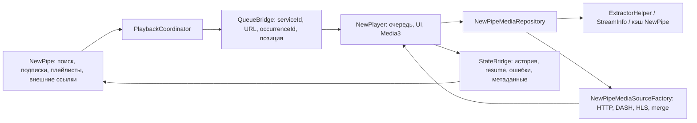

# NewPipe + NewPlayer: выбор основы и недостающие связи

> Текущий статус2026-10-22: [APK25](APK25_DEVICE_CHECKPOINT.md), [кандидат ZIP26](NEWPLAYER_SESSION_INTEGRATION.md), [актуальные refs/портирование](UPSTREAM_PORTING_20261022.md). Исторические результаты не переносятся на новый APK автоматически.

> Обновление 2026-10-21: основа заменена на актуальный NewPipe/dev и его Extractor.
> Текущий статус — [перенос основы](CURRENT_UPSTREAM_BASE.md). Ниже сохранена история предыдущих этапов.

Дата: 2026-10-20. Вид проверки: статический анализ исходников и публичных Git-метаданных.
Сборка, Gradle, unit/device-тесты и воспроизведение в рамках этого исследования не запускались.

## Вывод и решение

Рекомендуемая основа первого интеграционного этапа:

- NewPipe `refactor`, зафиксированный на `52886c235a210fa74806786697bac69f14ec7497`,
  с уже имеющимися локальными исправлениями сборки и ресурса `app_name`;
- NewPlayer `dev` **с Codeberg**, ревизия `212ca1c8d9419a19cb5aed7f0a61e22e8732a25c`;
- `frankenpipe` как источник небольших решений по подключению и встраиванию,
  с переносом по смыслу и указанием происхождения;
- актуальные NewPipe `master`/`dev` как контроль поведения и источник последующих
  исправлений, включая актуализацию Extractor.

Это рекомендация по результатам анализа, а не уже выполненная замена исходников.
В `NewPipe/` и `NewPlayer/` на этом этапе ничего не обновлялось.
Наша текущая копия NewPlayer существенно старее исследованного `dev`.

Причины выбора `refactor`: эта основа уже находится в нашем Git; её README прямо
направляет новые функции в `refactor`; Android-часть уже использует Hilt, как
NewPlayer; `VideoDetailFragment` уже на Kotlin. Изменение плеера можно выделить
от продолжающейся миграции общих экранов и настроек. Общая часть KMP остаётся
независимой от Android API плеера.

Ограничение выбора: HEAD `refactor` датирован 1 августа, тогда как `dev`
продолжает меняться в октябре. Свежие исправления из `dev` не считаются включёнными
автоматически. Ветки разошлись; `refactor` нельзя называть просто более новым `dev`.
Перед отправкой изменений исходной команде нужно заново проверить целевую ветку:
инструкция в README — свидетельство проверенной ревизии, а не обещание будущего
порядка приёма PR. Интеграцию следует держать отдельным набором коммитов, чтобы
при необходимости переносить её на согласованную командой ветку.

## 1. Какие исходники действительно сопоставлены

Ревизии получены через `git ls-remote`; даты — из публичных commit API.
Архивы скачаны по полным SHA, проверены по CRC, их SHA-256 записаны в манифест.

| Источник | Ревизия | Дата коммита | Значение для проекта |
| --- | --- | --- | --- |
| NewPipe `master` | `00acf2f318b0af7ffacbd687bba011b642cc01d0` | 2026-08-15 | Выпуск 0.29.1; контроль выпускаемой версии |
| NewPipe `dev` | `9c398043ec1489d691c2f7fa9b9fbcd48f3b307c` | 2026-10-20 | Текущая разработка; исправления и контроль сценариев |
| NewPipe `refactor` | `52886c235a210fa74806786697bac69f14ec7497` | 2026-08-01 | Выбранная Android/KMP-основа интеграции |
| NewPipe `frankenpipe` | `6c3f31a721083db03793f5eee61d3770e70da2b3` | 2024-12-25 | Ранний прототип подключения NewPlayer |
| NewPlayer Codeberg `dev` | `212ca1c8d9419a19cb5aed7f0a61e22e8732a25c` | 2026-10-20 | Выбранная актуальная библиотека, Media3 1.9.2 |
| NewPlayer Codeberg `master` | `89d6f16872f656dd62e47320d9cfd904f087b601` | 2024-10-28 | Старый снимок; имя `master` не означает свежую реализацию |

Официальные адреса: [NewPipe](https://github.com/TeamNewPipe/NewPipe),
[NewPlayer](https://codeberg.org/TeamNewPipe/NewPlayer).
GitHub-копия NewPlayer архивирована и направляет разработку на Codeberg.
На GitHub `dev` указывает на `0689d5d06974446c148db5b53048b39ed08d2cec`,
на Codeberg — на другую, более свежую ревизию из таблицы.
Проверка `https://codeberg.org/TeamNewPipe/NewPipe.git` вернула Repository not found;
оснований переносить источник NewPipe с GitHub в этом исследовании не получено.

Публичный compare API NewPipe подтвердил:

- `refactor...dev`: diverged, 171 коммит только справа и 444 только слева;
- `refactor...frankenpipe`: diverged, 8 коммитов только справа и 1230 только слева;
- `master...refactor`: diverged, 444 коммита только справа и 54 только слева.

Это метрики графа коммитов на момент проверки, не оценки объёма или сложности переноса.

Наша рабочая `NewPipe/` отличается от зафиксированного `refactor` только пятью
обычными файлами: `app/build.gradle.kts`, `ProjectConfig.kt`, version catalog,
Wrapper properties, базовый Compose `strings.xml`. Ещё один локальный файл
`app/src/main/res/values-iw` соответствует символической ссылке upstream, которая
при исследовательской распаковке пропущена. 4397 остальных обычных файлов
побайтно совпали. Это подтверждает происхождение локальной основы; восстановление
полной Git-истории upstream из исходного ZIP этим не производится.

## 2. Состояние трёх вариантов NewPipe

| Вариант | Что есть в коде | Что означает для выбора |
| --- | --- | --- |
| `master` / `dev` | Старый плеер на ExoPlayer 2.19.1; актуальные общие экраны и зависимости, Koin; готового подключения NewPlayer в проверенных точках нет | Нужны для сравнения поведения; прямой старт здесь добавляет отдельную задачу сопряжения с Hilt NewPlayer |
| `refactor` | ExoPlayer 2.19.1, Kotlin `VideoDetailFragment`, Hilt в Android App, KMP `shared`; NewPlayer ещё не подключён | Наименьшее изменение нашей проверенной пользователем основы; не требует завершить весь рефакторинг интерфейса |
| `frankenpipe` | Composite build NewPlayer и Extractor, Hilt provider, `NewPlayerView`, частичная переделка detail fragment | Полезный прототип встраивания; не готовая основа повседневного приложения |

В `frankenpipe/app/.../VideoDetailFragment.java:1169` метод `startNewPlayer()`
всегда передаёт URL `https://media.ccc.de/v/34c3-9072-bgp_and_the_rule_of_custom`.
Выбранные пользователем serviceId, URL, очередь и позиция до этого вызова
не доведены. Это конкретный разрыв, а не предположение по возрасту ветки.

`NewPlayerComponent.kt:67` использует `MediaCCCTestRepository`; его `fetchPage()`
жёстко выбирает `ServiceList.MediaCCC`. Субтитры и главы возвращаются пустыми,
timestamp-ссылка — пустой строкой. Присутствует отдельный тестовый repository
с фиксированным MP4. Такой код нельзя выдавать за универсальный адаптер YouTube.

`settings.gradle:7` дополнительно требует соседний локальный NewPipeExtractor,
а repository обращается к `MediaCCCRecording`. Поэтому прототип нельзя считать
воспроизводимым с любым случайным релизом Extractor. Его зависимость также нужно
идентифицировать при переносе кода; сам этот специфичный MediaCCC-путь переносить
в основную универсальную интеграцию не требуется.

Что брать из прототипа: идею локального подключения `:new-player`, предоставление
единственного NewPlayer в Application, вставку `NewPlayerView` в существующий
экран, направление событий Back. Что перепроектировать: repository, идентификаторы,
очередь, состояние экрана и жизненный цикл. Массово переносить закомментированные
ветви старого `VideoDetailFragment.java` в Kotlin-экран не следует.

## 3. Что изменилось в актуальном NewPlayer

Ранняя рекомендация «реализовать getStreams/getSubtitles/getHttpDataSourceFactory»
описывала нашу старую копию. Для выбранного актуального `dev` это уже другой API:

| Связь | Наша нынешняя копия | Codeberg `dev` |
| --- | --- | --- |
| Движок | Media3 1.8.0 | Media3 1.9.2 |
| Содержимое элемента | `getStreams(): List<Stream>` | `getMediaItem(): MediaItem` |
| Субтитры | Отдельный `getSubtitles()` | `MediaItem.subtitleConfigurations` |
| HTTP / составные потоки | Метод repository и собственная модель StreamSelection | Приложение задаёт `MediaSource.Factory` через `NewPlayerImpl.onNewPlayer` |
| Метаданные и дополнительные данные | Metadata, главы, preview | Эти связи остаются; появились `getLink()` и nullable URL timestamp-ссылка |
| Выбор дорожек | Незавершённый `ConstraintStreamSelector` возвращает старый выбор | Используются Media3 `Format`/Tracks, `selectVideoTrack`, `selectSubtitleLanguage`, языковые ограничения |
| События UI | Отдельные прежние callbacks/flows | `uiEvent: SharedFlow<NewPlayerUIEvent>` для Back, drag и внутренних share/browser событий |

В test-app уже есть пример `MergingMediaSourceFactory` и `MergedStreams`:
отдельные аудио/видео объединяются, причём сохраняются внешние mediaId/metadata.
Это подходящий референс, но его тестовые URL и repository не являются адаптером
реальных ответов Extractor. Путь HLS и все форматы, нужные NewPipe, надо явно
подключить и проверить: библиотека сейчас объявляет DASH, а полный набор источников
остаётся ответственностью host-приложения.

NewPlayer уже содержит MediaSessionService, обработку audio focus/noisy,
состояния очереди, fullscreen/PiP UI и механизмы ошибок. Они не равны завершённым
сценариям NewPipe: нет связи с его базой, навигацией и сервисами.
`BACKGROUND_AUDIO`/`BACKGROUND_VIDEO` в `PlayMode` помечены obsolete, а их ветви
в `UIModeState` содержат `TODO()`. Это не доказывает отсутствия всего фонового
воспроизведения; требуется использовать реально поддержанные режимы и сервис,
не отправляя host-события в эти устаревшие значения.

В актуальном `dev` также есть `:standalone-app` для файлов и прямых URL.
Это дополнительный пример хостинга NewPlayer, а не клиент YouTube и не замена
NewPipe. Старые планы в `assistant_plan.md` описывают прежний API; выводы выше
сделаны по действующим Kotlin-файлам.

## 4. Предлагаемая граница интеграции

Названия компонентов ниже проектные: этих классов в нашем приложении ещё нет.

- `NewPipeMediaRepository` живёт в Android-части приложения. Ключ элемента
  однозначно задаёт serviceId и канонический URL; сырая строка URL недостаточна
  для любых сервисов и дубликатов в очереди. OccurrenceId отличает два вхождения
  одного ролика, не подменяет его идентификатор для кэша.
- `NewPipeMediaSourceFactory` получает описание источников из одного согласованного
  snapshot StreamInfo. Поддерживает progressive, DASH/HLS, audio-only и раздельные
  аудио/видео. Повторяет необходимые заголовки и сетевые настройки NewPipe.
  Ошибка получения данных должна возвращаться выше; Media3 сам не заменяет Extractor.
- `PlaybackCoordinator` принимает существующие действия NewPipe и переводит их
  в вызовы NewPlayer. Приложение сохраняет свои списки, навигацию, загрузки и БД.
- `QueueBridge` и `StateBridge` имеют явные правила владельца состояния:
  активная playback-очередь одна; источник её обновлений и направление записи
  в NewPipe определены. Две независимо меняемые очереди создадут рассинхронизацию.
- Библиотека NewPlayer не должна импортировать классы NewPipe/Extractor/его БД.
  Android Media3/Hilt не переносятся в `shared/commonMain`.
- Локальное подключение библиотеки с фиксированными исходниками воспроизводимо;
  `master-SNAPSHOT` и незафиксированные скачивания не являются основой результата.
  Выбор между composite build и Android module закрепляется отдельным маленьким
  build-коммитом после согласования catalogs/plugins. `frankenpipe` уже показывает
  рабочую идею substitution; выполнение его сборки здесь не проверялось.

## 5. Реестр недостающих связей

Статус «есть API» означает наличие реализации/точки расширения в библиотеке,
а не успешную проверку сценария на устройстве. Во всех строках интеграция
NewPipe → NewPlayer в нашей рабочей копии пока отсутствует.

| ID / этап | Недостающая связь | Что уже есть | Что требуется и чем принять |
| --- | --- | --- | --- |
| G01 / A | Сборка и DI | Hilt App в refactor; NewPlayer provider/service | Подключить только библиотеку, один singleton; исключить конфликт plugin/catalog/Hilt; внешняя сборка и manifest review |
| G02 / B | Выбранное видео → item | StreamInfo в NewPipe; `getMediaItem` | Передавать реальный serviceId/URL, metadata; разные выбранные ролики воспроизводят разное содержимое |
| G03 / B | Форматы и сеть | Resolvers/data sources NewPipe; factory hook NewPlayer | Перенести HTTP-политику, progressive, DASH, HLS, merge аудио/видео; звук/видео синхронны, доступны live и audio-only |
| G04 / B | Действия открытия | NavigationHelper и PlayerIntentType | Open, autoplay, timestamp, resume, внешний share/deep link направить в coordinator; одинаковое поведение из поиска, подписок и плейлиста |
| G05 / C | Очередь | PlayQueue NewPipe; playlist NewPlayer | Play all, enqueue, enqueue next, lazy pages, duplicate items, remove/move, repeat/shuffle и autoqueue; нет потери или двойного запуска |
| G06 / C | История и позиция | HistoryRecordManager; Player events/position | Сохранять view/progress при pause, смене ролика и уходе; восстанавливать без дублированных записей |
| G07 / C | Сеть и настройки качества | ListHelper/preferences; Media3 track API | Ограничение мобильного качества, язык аудио, разрешение, скорость, pitch, skip silence; смена не теряет позицию |
| G08 / C | Субтитры | Extractor subtitles; MediaItem subtitle config/UI | Язык, формат и выбор/отключение; дорожки доступны и синхронизированы после переключения качества |
| G09 / C | Главы, preview и ссылки | Segments/preview NewPipe; repository methods | Маппинг глав и sprites, timestamp/share; правильная единица секунд/миллисекунд и правильный URL |
| G10 / C | Экран и Back | Kotlin detail screen; NewPlayerView/UI/uiEvent | Встроенный/fullscreen режим, ориентация, drag/minimize, Back; не пересоздавать очередь и не навязывать pause при каждом Back |
| G11 / D | Фон и уведомление | MediaSessionService NewPlayer | Продолжение при блокировке/уходе, audio focus, гарнитура, системные команды, notification tap/close; один активный сервис/notification |
| G12 / D | Popup и PiP | Overlay popup NewPipe; PiP NewPlayer | Сохранить привычный popup либо явно реализовать согласованную замену; PiP автоматически не равен overlay, особенно на API 23–25 |
| G13 / D | Android Auto / browsing | MediaBrowserServiceCompat и MediaBrowserImpl NewPipe | Сохранить browsing/search/queue и запуск через новый playback backend; один MediaSessionService NewPlayer сам каталог Auto не предоставляет |
| G14 / D | Lifecycle и восстановление | Application singleton, ViewModel, service | Rotation/recreation/PiP/foreground, сохранение очереди после смерти процесса; не путать повторный bind с новым play |
| G15 / B–D | Ошибки и URL refresh | ErrorInfo NewPipe; errorFlow/rescueStreamFault | Маппинг extracting/playback ошибок, bounded retry и invalidation истёкшего источника; показать причину без бесконечного запроса |
| G16 / C | Действия вокруг видео | NewPipe download/external/Kodi/bookmarks | Сохранить действия в родительском экране и списках; библиотека не обязана заново реализовывать downloader NewPipe |
| G17 / E | Проверяемость | Отдельные unit-наборы и test-app | Тесты адаптера, очереди/истории и внешняя матрица device-сценариев; отчёты разделяют источник ошибки и playback |
| G18 / E | Использование командой | Локальный Git, provenance upstream | Фиксированные SHA, README интеграции, маленькие diff/коммиты, схема API, примеры и ограничения, сохранённые лицензии/авторы |

Особые основания G05/G06/G13: старый `Player.java` сам регистрирует просмотр,
сохраняет progress и достраивает autoqueue; `NavigationHelper.java` отправляет
действия старому PlayerService; `PlayerService.kt` наследует
`MediaBrowserServiceCompat`. Замена виджета на экране эти связи не перенаправляет.

## 6. Порядок реализации и критерий успеха

**A. Зафиксировать новую библиотеку и build-сопряжение.** Обновление исходников
NewPlayer отдельным коммитом с provenance; перенести наши необходимые build-правки.
Сохранить floor Gradle 9.6.1 / AGP 9.4.0 / JDK 21 / compileSdk 37.
Сохранить более свежие требования NewPlayer, в частности Media3 1.9.2,
Hilt 2.60.1 и Build Tools 36.1.0. Совместимость с прежними dependency constraints
нужно проверить на основном компьютере. `composeOptions` 1.5.1 и Java 11 output
в upstream не копируются поверх уже выполненной нашей миграции без разбора.
Нативная nextlib-зависимость относится к `standalone-app`; она не становится
обязательной частью интеграции NewPipe только из-за наличия в catalog.

**B. Вертикальный сценарий.** Реальный выбранный ролик → Extractor → repository
→ MediaItem/factory → NewPlayer → экран результата/ошибки. Начать с обычного
progressive и раздельных YouTube аудио/видео; дополнить live/DASH/HLS.
Прототип с фиксированным файлом не закрывает этап. Проверить также сервис,
не требующий YouTube, чтобы разделять проблемы интеграции и отказ сервера.

**C. Поведение NewPipe.** Очередь, навигация, история/resume, дорожки,
субтитры, главы и настройки; затем тесты этих переходов.

**D. Системные сценарии.** Фон, уведомления, lifecycle, fullscreen/PiP/popup,
Android Auto. После матрицы убрать или изолировать старый playback path:
сценарий не считается мигрированным, если фактически продолжает играть через
старый ExoPlayer. На промежуточном этапе fallback помечается явно в отчётах.

**E. Передаваемый результат.** Исходный ZIP с Wrapper и фиксированными
зависимостями, инструкция воспроизведения, diff интеграции отдельно от build
и документации, отчёты, список оставшихся ограничений. Публикация GitHub или
отправка PR исходной команде этим исследованием не выполняется.

Матрица приёмки для основного компьютера; сейчас **все пункты NOT RUN**:

| Проверка | Ожидаемый результат |
| --- | --- |
| Открыть A из поиска, затем B из подписок | NewPlayer играет выбранный ролик; metadata и экран совпадают |
| Внешняя YouTube-ссылка с timestamp | Правильное видео и стартовая позиция |
| Progressive / разделённые аудио+видео / HLS / DASH / live | Поддержанные источники играют, дорожки и длительность корректны |
| Play all, enqueue next, reorder/remove, duplicate URL | Порядок, текущая позиция и отдельные вхождения не теряются |
| Pause → закрыть экран → вернуться | Корректная история, resume, пауза/воспроизведение сохраняются |
| Менять качество, язык и субтитры | Выбор применён, позиция сохранена, доступно отключение субтитров |
| Fullscreen, Back, rotation, PiP, popup | Согласованное поведение без второго плеера и сброса очереди |
| Заблокировать экран, гарнитура и notification | Фоновый режим и команды работают, звук не дублируется |
| Android Auto browse/search/play | Каталог и запуск используют новый backend |
| Потеря сети / истёкшая ссылка / отказ YouTube | Понятная ошибка или ограниченное восстановление, нет бесконечного retry |
| История/плейлисты/import-export/download/external player | Сценарии NewPipe вокруг плеера сохранены |
| Сборка с чистой распаковки по инструкции другим участником | Исходники и фиксированные зависимости достаточны для повторения |

Отказ YouTube «подтвердите, что вы не бот» остаётся ошибкой получения данных.
Успешная интеграция плеера не гарантирует доступ сервера. Авторизация не является
автоматически добавленным требованием этого этапа; при необходимости она будет
отдельной задачей в слое получения данных.

## 7. Карта доказательств для ревью

Пути относительно соответствующего снимка из раздела 1; номера строк относятся
только к зафиксированным ревизиям.

| Метка | Файл / точка чтения | Что подтверждает |
| --- | --- | --- |
| E01 | NewPipe-refactor `README.md:1`, `settings.gradle.kts`, `App.kt:62` | Направление новых функций, граница KMP и Hilt host |
| E02 | NewPipe-frankenpipe `settings.gradle:7,14`, `app/build.gradle:208` | Локальное подключение двух отдельных проектов |
| E03 | NewPipe-frankenpipe `app/src/main/java/org/schabi/newpipe/NewPlayerComponent.kt:67,165,170` | Тестовый provider и MediaCCC-only repository |
| E04 | NewPipe-frankenpipe `app/src/main/java/org/schabi/newpipe/fragments/detail/VideoDetailFragment.java:313,1169,1265` | ViewModel, фиксированный ролик, NewPlayerView |
| E05 | NewPlayer-dev `new-player/src/main/java/net/newpipe/newplayer/repository/MediaRepository.kt:70` | Актуальный контракт MediaItem/metadata/chapters/links |
| E06 | NewPlayer-dev `new-player/src/main/java/net/newpipe/newplayer/NewPlayerImpl.kt:86,587` | Custom builder и базовая настройка Media3 |
| E07 | NewPlayer-dev `test-app/src/main/java/net/newpipe/newplayer/testapp/MergingMediaSourceFactory.kt:34` | Пример объединения источников |
| E08 | NewPlayer-dev `new-player/src/main/java/net/newpipe/newplayer/NewPlayer.kt:228` | Операции playlist, незавершённое удобное API enqueue-next/bulk |
| E09 | NewPlayer-dev `new-player/src/main/java/net/newpipe/newplayer/data/PlayMode.kt:59`, `uiModel/UIModeState.kt:318` | Устаревшие background enum-ветви |
| E10 | NewPlayer-dev `new-player/src/main/java/net/newpipe/newplayer/service/NewPlayerService.kt:55` | MediaSessionService, а не каталог MediaLibraryService |
| E11 | NewPipe-refactor `app/src/main/java/org/schabi/newpipe/util/NavigationHelper.java:91,153,166,215` | Старые точки запуска/enqueue |
| E12 | NewPipe-refactor `app/src/main/java/org/schabi/newpipe/player/Player.java:1865,1880,1991` | История, position, autoqueue |
| E13 | NewPipe-refactor `app/src/main/java/org/schabi/newpipe/player/PlayerService.kt:45` | Старый MediaBrowserServiceCompat |
| E14 | NewPlayer-dev `new-player/build.gradle.kts`, `gradle/libs.versions.toml:40` | Текущие build/dependency требования |

Удобные постоянные ссылки:
[frankenpipe: запуск](https://github.com/TeamNewPipe/NewPipe/blob/6c3f31a721083db03793f5eee61d3770e70da2b3/app/src/main/java/org/schabi/newpipe/fragments/detail/VideoDetailFragment.java#L1169),
[frankenpipe: provider](https://github.com/TeamNewPipe/NewPipe/blob/6c3f31a721083db03793f5eee61d3770e70da2b3/app/src/main/java/org/schabi/newpipe/NewPlayerComponent.kt#L67),
[NewPlayer: repository](https://codeberg.org/TeamNewPipe/NewPlayer/src/commit/212ca1c8d9419a19cb5aed7f0a61e22e8732a25c/new-player/src/main/java/net/newpipe/newplayer/repository/MediaRepository.kt),
[NewPipe: refactor](https://github.com/TeamNewPipe/NewPipe/tree/52886c235a210fa74806786697bac69f14ec7497).

## 8. Артефакты и пределы проверки

Рядом с рабочим репозиторием, в
`03 delivery/newplayer-comparison-20261020-01/`, сохранены:

- исходные upstream ZIP и распакованные снимки `sources/`;
- `upstream-snapshots.json` с URL, полными SHA, SHA-256 ZIP и пропущенными symlinks;
- `commit-metadata.json` с исходными ответами commit/compare API;
- `tree-comparison.json` с побайтным сравнением деревьев;
- вспомогательные `fetch_snapshots.py` и `inspect_snapshots.py`, которые читают
  исходники/метаданные и не запускают проект.

Минимальный манифест источников также сохранён в Git как
[UPSTREAM_SOURCES.json](UPSTREAM_SOURCES.json).
Символические ссылки из архивов не исполнялись и не создавались; они перечислены
в манифесте. Оригинальные `01 start` и ранее выданные ZIP не менялись.

Пользователь сообщил об успешной сборке двух прежних приложений на основном
компьютере. Это относится к прежним отдельным исходникам, а не к скачанному
сегодня NewPlayer и не к интеграции. Протокол unit/device-проверок к этому
сообщению не приложен; результаты таких проверок здесь не приписываются.

Итог текущего этапа: выбранная пара основ, доказательства, G01–G18 и матрица
приёмки. Критерий конечного успеха проекта ещё не достигнут: NewPipe пока
не воспроизводит свои сценарии через NewPlayer.
